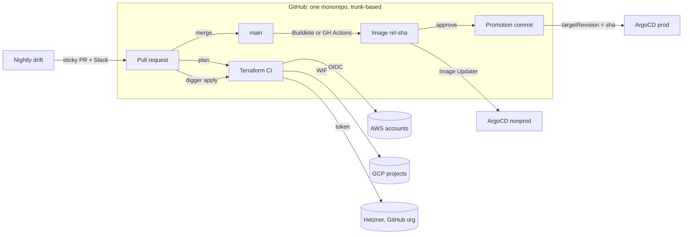

# Platform Blueprint

[](https://github.com/leoenes/platform-blueprint/actions/workflows/ci.yml)
[](https://leoenes.github.io/platform-blueprint/)
[](LICENSE)


How I build and operate a platform:
a multi-account, multi-region, multi-cloud platform in one monorepo,
delivered trunk-based, with every infrastructure change planned in a PR,
applied from the PR, and checked for drift every night.

Everything here is sanitized (fictional `acme` org, placeholder account IDs,
projects and domains). The patterns, scripts and workflows are the real ones,
reduced to what explains the design.

## Fixed points and free choices

| Fixed | Free (shown with more than one option) |
| --- | --- |
| GitHub for source, PRs and Terraform CI | **Cloud**: AWS (primary), GCP, Hetzner, GitHub-as-infra. One `envs` map in `root.hcl` |
| OpenTofu + Terragrunt for infrastructure | **CD tool**: Buildkite or GitHub Actions, same scripts through a small adapter |
| ArgoCD for cluster reconciliation | **Registry**: ECR, Artifact Registry or GHCR, by config |
| One `.platform/` contract per app | **Language**: Go and Python examples; any directory with a Dockerfile and `make test lint` is an app |



## What is in here

| Area | Where | Why it is built this way |
| --- | --- | --- |
| Terragrunt + OpenTofu layers | `infra/terraform/` | path = cloud + tenant + region + layer; a new region is a directory, the inventory and dependency order are generated from the tree |
| PR-driven plan/apply | `.github/workflows/terraform*.yml`, `digger.yml` | plans in parallel, applies in dependency order, against the plan that was reviewed |
| Drift detection | `.github/workflows/terraform-drift.yml` | the console is not an input; nightly plans become evidence in one sticky PR |
| Trunk-based delivery | `infra/delivery/`, `.buildkite/`, `.github/workflows/delivery.yml` | main builds immutable images; nonprod follows automatically, prod is a reviewed commit |
| GitOps | `infra/platform-config/`, `infra/helm-charts/` | ArgoCD app-of-apps; ApplicationSets rendered per cluster; an app joins a region by adding one values file |
| Human access registry | `infra/access/`, `modules/human_access` | one YAML per person drives SSO, GitHub, VPN, Slack and database roles |
| Notifications | `.github/scripts/*/notify-*.sh`, `infra/delivery/scripts/slack-notify.sh` | Slack is for outcomes people act on: applies, drift, promotions, failures, cost |
| Portability | `layers/workloads/gke`, `layers/workloads/hetzner-k3s`, `layers/foundations/github-org` | same conventions on three more providers |

## Read in this order

Rendered with diagrams at **https://leoenes.github.io/platform-blueprint/**, or in `docs/` here.

1. [Architecture](docs/01-architecture.md): tenants, regions, clouds, blast radius.
2. [Terraform and Terragrunt](docs/02-terraform-terragrunt.md): the layer model, state and auth per cloud.
3. [PR workflow](docs/03-pr-workflow.md): how a change gets planned, reviewed and applied.
4. [Drift detection](docs/04-drift-detection.md): nightly plans, sticky PR, Slack.
5. [Trunk-based delivery](docs/05-trunk-based-delivery.md): images, previews, promotion, two CD tools.
6. [GitOps with ArgoCD](docs/06-gitops.md): app-of-apps, ApplicationSets, overlays.
7. [Human access](docs/07-human-access.md): the registry and what it drives.
8. [Notifications](docs/08-notifications.md): what goes to Slack and why.
9. [Portability](docs/09-portability.md): clouds, CD tools, languages, and earlier projects.
10. [Decision records](docs/adr/): one page per tool choice.

## Tooling

| Tool | Role | Why |
| --- | --- | --- |
| OpenTofu | Terraform engine | open licence, drop-in, state encryption |
| Terragrunt | orchestration | derives backend, tenant and identity from the path; keeps modules clean |
| Digger (config) + GitHub Actions | IaC CI | plan/apply from the PR; dependency-ordered stages; no long-lived keys |
| GitHub OIDC / GCP WIF | cloud auth for CI | one trust policy per tenant, zero static credentials |
| Buildkite *or* GitHub Actions | app delivery | same scripts; block steps or environment approvals for prod |
| ArgoCD + Image Updater | cluster reconciliation | git is the source of truth; nonprod auto-follows, prod needs a commit |
| Karpenter / GKE Autopilot | node capacity | right-sized nodes on demand, spot in nonprod |
| External Secrets + SOPS | secrets | ESO for runtime, SOPS only for the handful needed before ESO exists |
| Infracost | cost of drift | a drifted layer is shown with its monthly cost |
| Renovate + Danger | hygiene | grouped, approved dependency PRs; Conventional Commits enforced |
| mise | toolchains | one pin file per app and one for infra; laptops and CI run the same binaries |

## Running the checks

Nothing here applies anywhere without tenants, OIDC trust and secrets, but
everything that can be verified offline is:

```sh
mise install     # pins tofu, terragrunt, helm, jq, yq, shellcheck, actionlint
make check       # fmt, shellcheck, actionlint, helm lint/render per cluster, inventory, staging dry-run
make help        # the rest: render a cluster, regenerate the inventory, plan helpers
```

## About

I am a platform engineer. This repository is how I like to build: one
monorepo, every change through a reviewed PR, nothing applied from a laptop,
and every tool replaceable except the source of truth. The structure, the
scripts and the workflows here are the ones I use, reduced to what explains
the design. The same conventions have carried across Hetzner, AWS and GCP,
across Buildkite and GitHub Actions, and across Go, Python, TypeScript and
Elixir services. See [Portability](docs/09-portability.md).
