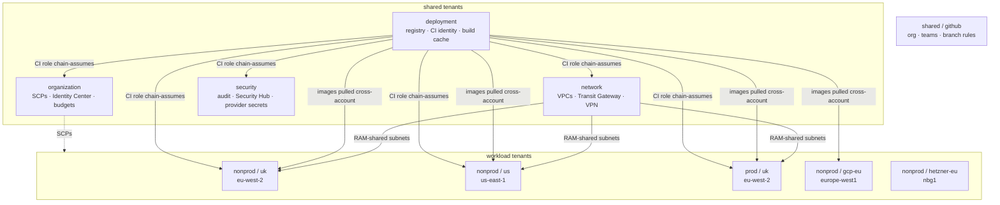
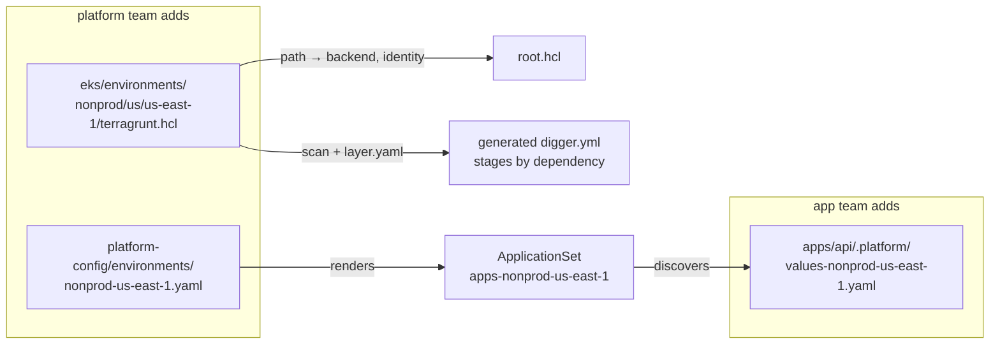
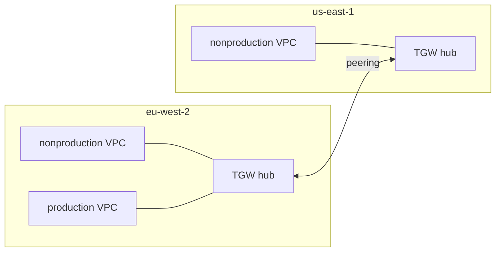
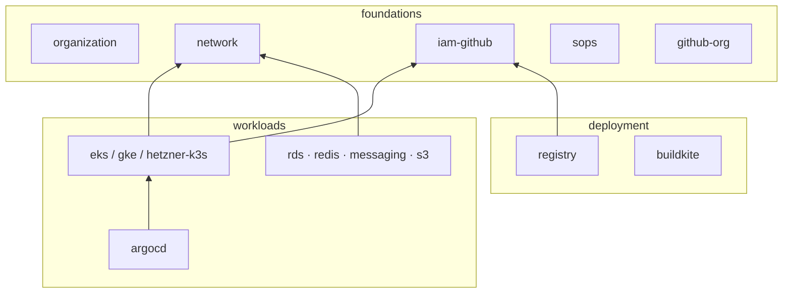

# Architecture

## Tenants: one per blast radius, on any cloud

A *tenant* is the unit of isolation a cloud offers: an AWS account, a GCP
project, a Hetzner project, a GitHub organization. Nothing shares state,
credentials or a network with a tenant it does not need to.

| Tenant (`<stage>/<leader>`) | Cloud | Holds | Why separate |
| --- | --- | --- | --- |
| shared/organization | AWS | Organizations, SCPs, Identity Center, budgets | the root of trust; almost never changes |
| shared/network | AWS | VPCs, Transit Gateways, VPN connector, flow logs | shared by workload accounts via RAM; no workload can delete a subnet |
| shared/security | AWS | Security Hub, audit logs, provider secrets | read by many, written by few |
| shared/deployment | AWS | registry, CI roles, build cache | the only tenant CI logs into directly |
| nonprod/uk, nonprod/us | AWS | EKS, RDS, Redis, queues | per-region nonprod, each can be rebuilt alone |
| prod/uk | AWS | the same layers as nonprod | prod differs by inputs, not by code |
| nonprod/gcp-eu | GCP | GKE Autopilot, Secret Manager | a second cloud with the same conventions |
| nonprod/hetzner-eu | Hetzner | k3s, Cloudflare DNS | a provider with no state service |
| shared/github | GitHub | members, teams, repo, branch protection | infrastructure that is not a cloud |

Every tenant has its own state location. A mistake in one tenant's state
cannot touch another's.

## Regions: discovered, never listed

Nothing in the repository enumerates regions. Each per-region thing is one
file in a conventional place, and everything else finds it.

| Who adds a region | Adds | Discovered by |
| --- | --- | --- |
| an app team | `apps/<app>/.platform/values-<stage>-<region>.yaml` | that cluster's ApplicationSet |
| the platform team | one `terragrunt.hcl` per layer the cluster needs | `root.hcl` and the inventory generator |
| the platform team | `platform-config/environments/<stage>-<region>.yaml` | the cluster's ArgoCD root app |

Two AWS regions share nothing but a Transit Gateway peering, declared as an
instance-level dependency so the accepter applies after the requester.

## Layers

A layer is one Terraform root. An *instance* is one directory with one
`terragrunt.hcl` holding only inputs. One instance = one state file = one
CI project.

## Ownership

| Owns | What |
| --- | --- |
| Terraform | cloud resources, IAM, the ArgoCD install and root apps |
| The CD tool (Buildkite or GitHub Actions) | image builds and the prod promotion commit |
| ArgoCD | everything running in a cluster |
| The registry (`infra/access/`) | who can reach what |

No component crosses into another's area. ArgoCD never runs Terraform;
Terraform never deploys an app; CI never writes to a cluster.
