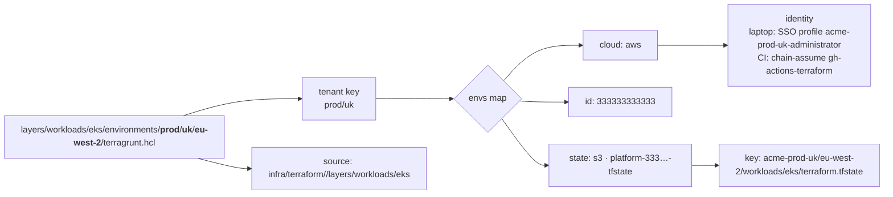
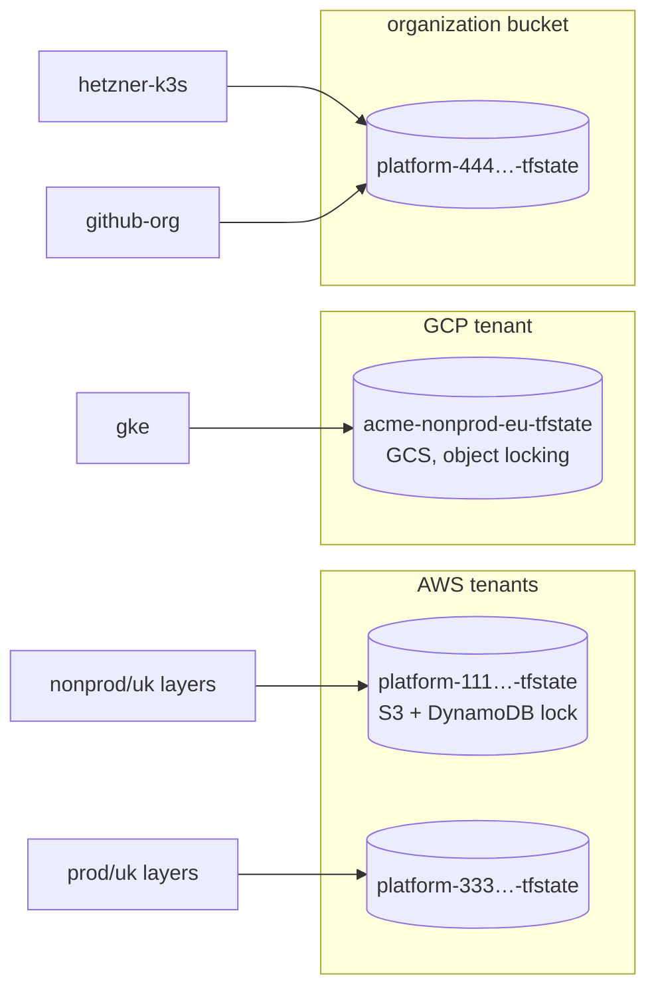
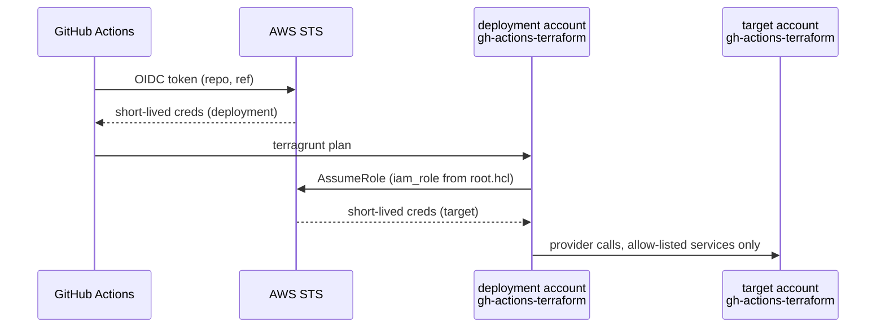

# Terraform and Terragrunt

## The path is the configuration

```
infra/terraform/layers/<category>/<layer>/environments/<stage>/<leader>/<region>/terragrunt.hcl
```

`root.hcl` splits that path and derives everything else from one `envs` map.



| From the path | Derived |
| --- | --- |
| `<stage>/<leader>` | tenant: cloud (`aws`, `gcp`, `hetzner`, `github`), id (account, project or org) |
| tenant | state backend (`s3` or `gcs`), bucket, lock table |
| tenant | SSO profile locally, IAM role to chain-assume in CI (AWS only) |
| `<category>/<layer>` | Terraform source directory and state key |

`<leader>` is a country for the primary cloud (`uk`, `us`), `<cloud>-<area>`
for other clouds (`gcp-eu`, `hetzner-eu`), or a shared role. An instance
file contains only inputs:

```hcl
include "root" { path = find_in_parent_folders("root.hcl") }
inputs = { cluster_name = "nonprod-uk", cluster_version = "1.37", vpc_tier = "nonproduction" }
```

## Why Terragrunt, why OpenTofu

| Choice | Reason |
| --- | --- |
| Terragrunt | one backend block for the repo; account, role and region cannot be mistyped because they come from where the file is; `-lock-timeout=15m` in one place so CI, drift and laptops queue instead of failing |
| OpenTofu | drop-in engine under an open licence, state encryption, pinned in `mise.toml` so laptops and CI run the same binary |

The `//` in `terraform { source = ".../infra/terraform//layers/<category>/<layer>" }`
widens the copied tree so `../../../modules/*` references still resolve
inside `.terragrunt-cache`.

## State



- Key: `<env>/<region>/<category>/<layer>/terraform.tfstate` everywhere.
- AWS buckets are versioned, KMS-encrypted and TLS-only, with a lock table.
- Providers without a state service use the organization account's bucket
  under their own prefix.
- Created once per tenant by `infra/terraform/setup` with local credentials,
  the only thing ever applied outside CI.

## Authentication: no static credentials anywhere



| Cloud | Laptop | CI |
| --- | --- | --- |
| AWS | SSO profile named after the account; `make plan-ro` forces the `-readonly` profile and refuses ambient credentials | OIDC into the deployment account, then Terragrunt `iam_role` chain-assumes into the target account |
| GCP | `gcloud auth application-default login` | Workload Identity Federation, no key file |
| Hetzner, Cloudflare, GitHub | token in the shell from the secrets store | token read from the secrets store at run time, masked, never a repo secret |

The CI role in each AWS account is an explicit service allow-list with a deny
on IAM users, access keys and the organization. There is no
`AdministratorAccess` in the pipeline. The stage workflow picks the auth step
from the instance path, so adding a cloud is one more conditional step.

## Conventions that avoid drift

- Cluster KMS administrators pinned to account root, not the caller ARN,
  because alternating SSO and CI applies produced a one-resource diff every run.
- EKS access is declared through access entries, never inherited from
  whoever ran `apply`.
- Stable resource names wherever a Kubernetes manifest references them
  (the Karpenter node role).
