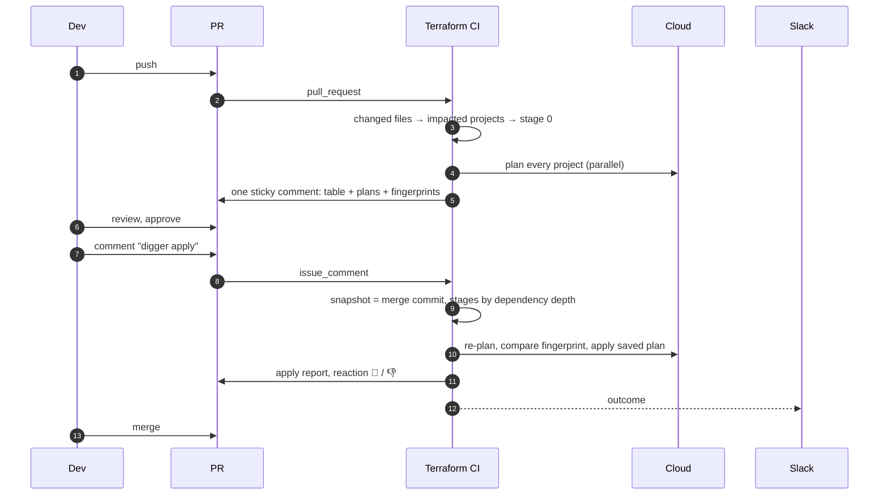
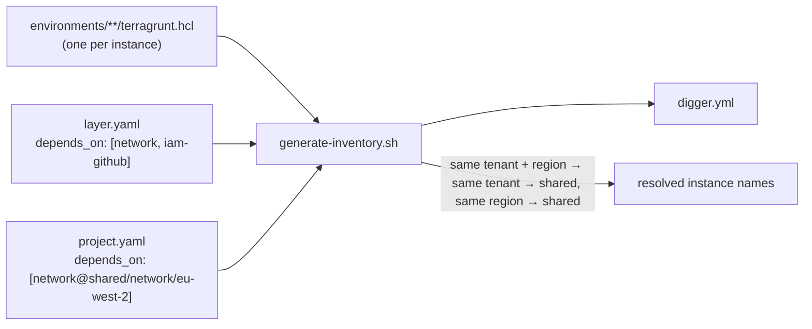
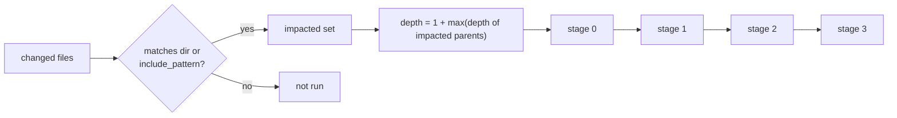
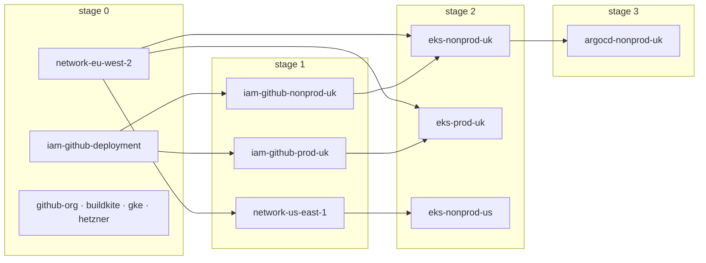
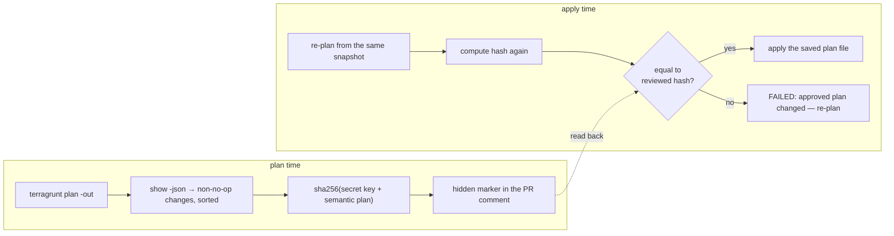

# PR workflow: plan, review, apply, merge

## Why apply before merge

Main must describe what exists. If the apply happened after merge and
failed, main would be wrong until someone fixed it. Applying from the PR
means a failed apply leaves main untouched and the PR open with the error.
A reminder nags twice a day about PRs that were applied but not merged.

## The inventory is generated

`digger.yml` lists one project per Terragrunt instance with
`include_patterns` (what changes affect it) and `depends_on` (what must
apply first). It is generated from the directory tree and checked for
staleness on every PR.

- A layer declares what it needs by layer name; the generator resolves to the
  closest instance and never makes prod depend on nonprod.
- `layer@stage/leader[/region]` pins an instance; `project.yaml` adds
  instance-specific dependencies (the Transit Gateway peering accepter).
- A new region is new instance directories and nothing else.

## From a diff to stages

Rules that matter:

1. `depends_on` only orders; it never adds projects. A change to the network
   layer does not re-apply every cluster.
2. Plans are flattened to stage 0 (read-only, run them all at once).
   Applies and drift use the real depth.
3. Stage N runs after N-1 and, in apply mode, only if N-1 succeeded.

With the whole inventory selected, the stages come out as:

## The plan fingerprint

The thing reviewed must be the thing applied.

On apply, the project is re-planned from the same snapshot and the hash must
match. If the world moved (a console click, a parent layer's outputs), the
apply refuses. If it matches, the *saved plan file* is applied, not a fresh
plan. The key keeps a PR author from forging the marker.

## Where it runs

The `detect` job needs no cloud and always runs, so every PR shows which
projects it impacts and in which stage. The stage jobs assume cloud roles, so
they run only where the repository variable `TERRAFORM_CI` is `enabled`,
which is how this public copy stays green without any account behind it.

## Guards on apply

| Guard | Why |
| --- | --- |
| commenter has write permission | not everyone who can read may apply |
| PR mergeable, approved on the current head | a review of an older push does not count |
| snapshot = merge commit at comment time | a push during the run does not change what is applied |
| no re-run of a failed apply job | post a new comment; the snapshot is recomputed |
| concurrency group `tf-state-<dir>` | plans, applies and drift on the same state queue, nothing is cancelled |
| `max-parallel: 6` | one PR cannot occupy every runner |
| applies never retried automatically | a partial apply is a human decision |

## What the PR sees

One comment per mode, updated in place:

| Stage | Project | Result | Summary |
| --- | --- | --- | --- |
| 0 | `network-eu-west-2` | ✅ OK | Plan: 2 to add, 0 to change, 0 to destroy. |
| 1 | `eks-nonprod-uk` | ✅ OK | No changes |

Projects with changes or failures expand to the filtered plan output.
Unchanged projects stay on one line. Missing results are counted and block
the apply.
