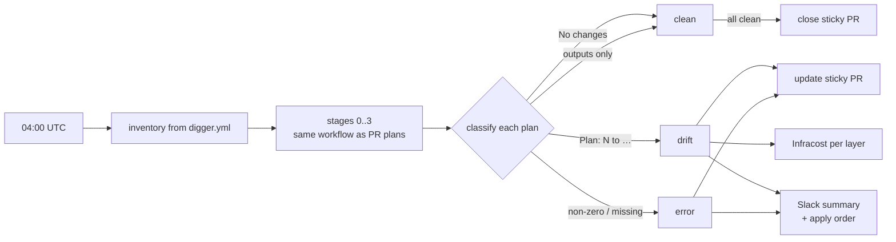
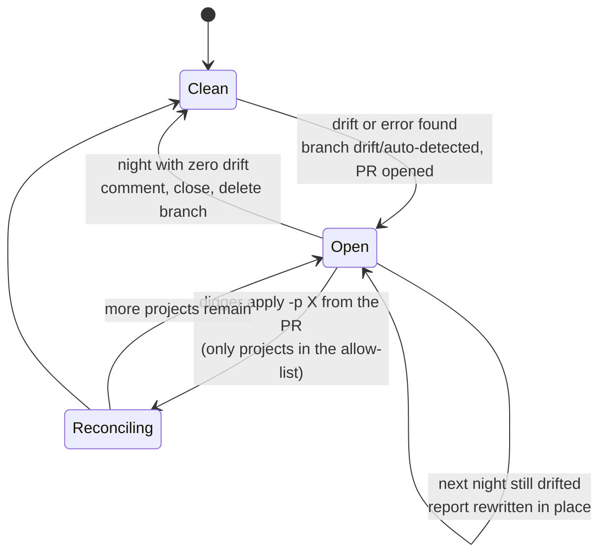

# Drift detection

Every night at 04:00 UTC every project is planned against main, using the
same reusable stage workflow as PRs. The console is not an input; if reality
and git disagree, git wins and the difference becomes evidence.



| Plan result | Class |
| --- | --- |
| `No changes` | clean |
| `Changes to Outputs` only | clean (outputs are not infrastructure) |
| `Plan: N to add/change/destroy` | drift |
| non-zero exit | error |
| no result at all | error, fail closed: a lost shard is never "clean" |

## Evidence: one sticky PR



The PR body carries a table of projects, each plan in a collapsible block,
and a hidden allow-list `<!-- drift-allowed-projects: a b c -->`. The PR is
never merged. The apply authorizer accepts `digger apply -p <project>` from
it only for listed projects, so a drift PR cannot be used to apply something
unrelated.

## Cost of drift

For each drifted layer, Infracost computes the monthly cost of the layer and
it is shown next to the plan summary. It answers "is this a $5 tag or a
$3,000 instance?" before anyone opens the plan.

## Slack

```
🚨 Terraform drift detected
3 drifted · 0 plan error(s) · workflow run · drift PR #412

Drifted projects
• eks-nonprod-uk — Plan: 0 to add, 1 to change, 0 to destroy · monthly cost: $1,420.10
• network-eu-west-2 — Plan: 1 to add, 0 to change, 0 to destroy · monthly cost: $96.40

Suggested apply order (respecting depends_on)
1. digger apply -p network-eu-west-2
2. digger apply -p eks-nonprod-uk
```

The apply order is a topological sort of `depends_on` restricted to drifted
projects, so the reader does not have to work it out.

## Design choices

- Reuse the PR stage workflow: drift runs are plans with a different
  selection scope, not a second implementation.
- Validate that every expected project reported. Missing results are errors,
  not silence.
- The drift PR is exempt from the PR-size rule, but only when it comes from
  this repository (a fork can name a branch the same).
