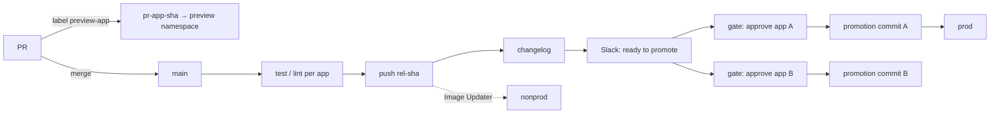

# Trunk-based delivery

One branch, short-lived PRs, every merge to main produces a deployable
image, and promotion to production is a reviewed git commit. The graph is
defined once in `infra/delivery/scripts/` and driven by either Buildkite or GitHub
Actions; see `infra/delivery/README.md` for the adapter.

## Any language

An app is a directory with a `Dockerfile`, a `Makefile` with `test` and
`lint`, and a `.platform/` contract. The pipeline runs `make test lint` and
`docker buildx build`; it does not know whether the app is Go, Python,
TypeScript or Elixir. Toolchains are pinned per app in `mise.toml`. Private
package indexes are BuildKit secrets, never build args.

## Images

| Branch | Tag | Repository |
| --- | --- | --- |
| main | `rel-<40-hex sha>` | `<app>` (release) |
| PR | `pr-<app>-<sha>` | preview repository |

Tags are immutable. If the tag already exists the build is skipped, so
re-running a pipeline costs nothing and can never produce a different image
for the same commit. Registry kind (ECR, Artifact Registry, GHCR) is
configuration; login, existence check and the prod keep-tag are implemented
per kind. Images carry provenance and an SBOM.

## Affected apps only

The pipeline is generated per commit. An app is built if its directory, a
path it declares in `deps.txt`, or the shared service chart changed. A
shared package change therefore builds every app that uses it, and its
commits appear in each of those apps' changelogs.

## Nonprod: no human step

ArgoCD Image Updater watches the registry for `^rel-[0-9a-f]{40}$` and writes
the newest tag into the Application. A merge is live in nonprod within
minutes. Nothing is committed for this.

## Prod: a commit, with a gate

1. `promotions-ready` posts to Slack and unlocks **one gate per app**.
   Gates depend on the notify step, not on each other, so approving app A
   never waits for app B, and a red build shows no gate.
2. The gate records a decision (approve / reject) and whether to take an
   on-demand database recovery point first. Only named teams can approve.
3. `promote-to-prod.sh` writes `image.tag` into every `values-prod-*.yaml`
   of the app, commits as the deploy bot with the changelog and the
   approver's name, and pushes to main with `[skip ci]`.
4. The ArgoCD prod ApplicationSet renders that app at the SHA inside the
   tag, so unpromoted changes to the app's values never reach prod.
5. A `keep-prod-<sha>` tag protects the image from lifecycle expiry.
6. Older pending promotions of the same app whose commit is an ancestor of
   this one are cancelled.

The **regression guard** runs before fetch, after fetch and after the
backup: if the current prod SHA already contains the new SHA, the step exits
cleanly. Prod never moves backwards by accident.

| Gate mechanics | Buildkite | GitHub Actions |
| --- | --- | --- |
| the gate | block step with `decision` and `backup` select fields | `production` environment, required reviewers |
| who may approve | `allowed_teams` | environment reviewers |
| approver identity | `BUILDKITE_UNBLOCKER` | `github.triggering_actor` |
| stale gates | API call rejects superseded blocks | concurrency group cancels older pending runs |

## The CD tool is infrastructure too

What you would click in the CD tool's UI is Terraform:

| Tool | Layer | Manages |
| --- | --- | --- |
| Buildkite | `deployment/buildkite` | cluster, queue, agent token, the pipeline and its GitHub settings, teams and members from the access registry, which teams may manage builds |
| GitHub Actions | `foundations/github-org` | the `production` environment, its reviewer teams from the registry, branch policy |

Only the per-commit step list is generated at run time, because "build the
affected apps only" cannot be a static definition. Everything else (who may
unblock, which branch may promote, where agents run) is reviewed in a PR and
drift-checked like any other layer.

## Credentials

The CI's OIDC token is exchanged for a cloud identity by trust level:

| Level | Trust | Can |
| --- | --- | --- |
| general | any branch | push to the preview repository, read the PR-comment app secret |
| prod | default branch only (cloud trust policy checks the token's branch claim) | push release repositories, read the deploy app key, create recovery points |

Two GitHub Apps with disjoint permissions: one for PR comments, one for the
promotion push (and the branch-protection bypass). Neither is a user token.

## Failures

Hard failures on main post to a separate channel from deploys: a trap in
Buildkite steps, a `failure()` job in GitHub Actions. People who approve
promotions are not the people who debug the runner image.

## Previews

Label a PR `preview-<app>`; the PR build pushes `pr-<app>-<sha>` and the
preview ApplicationSet creates `preview-<app>-<n>` with an in-cluster
database. Removing the label or closing the PR prunes it. A label
`link-<other-app>-<pr>` points this preview at another PR's preview.
