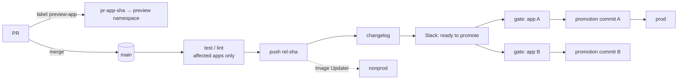
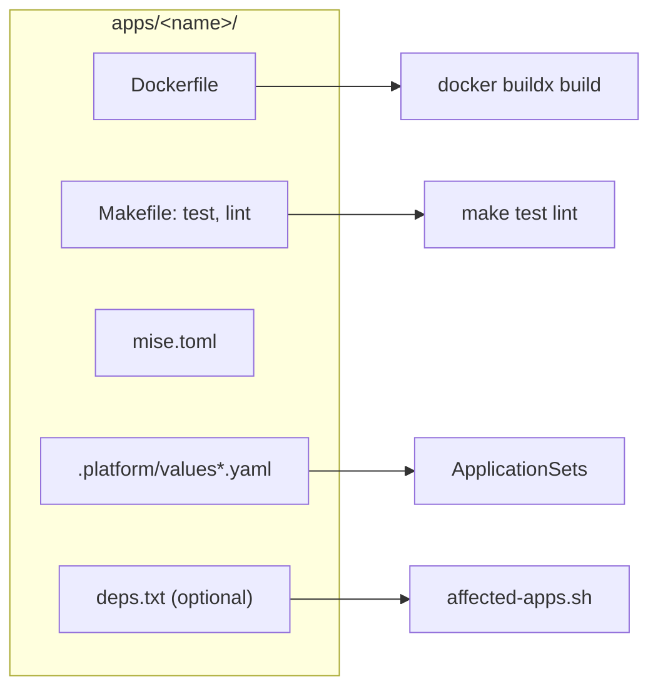
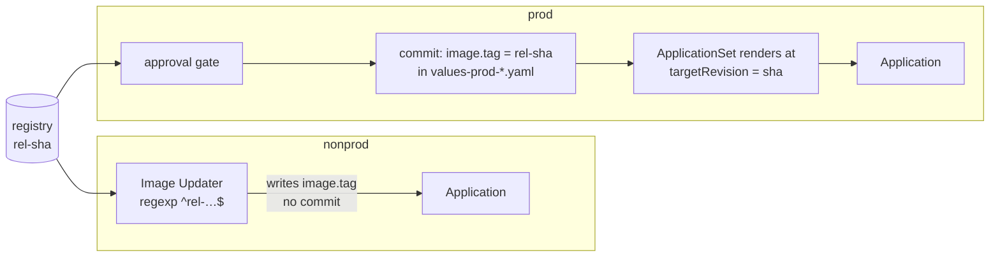
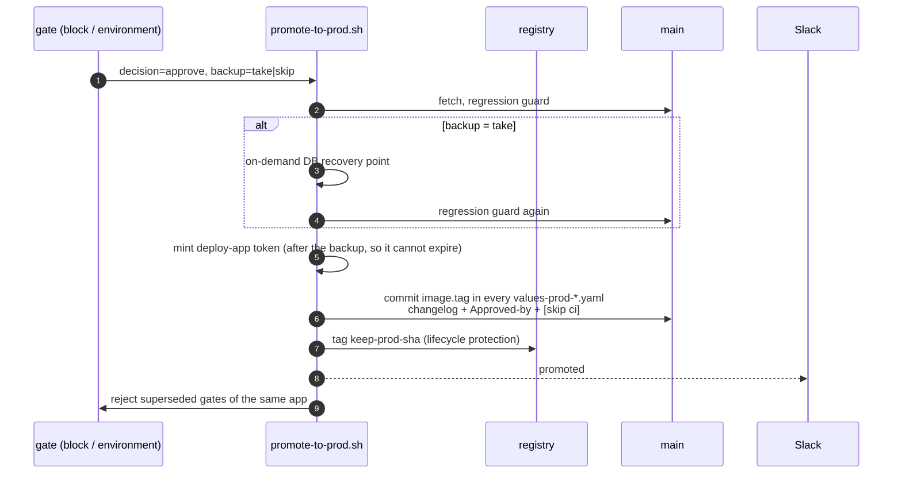
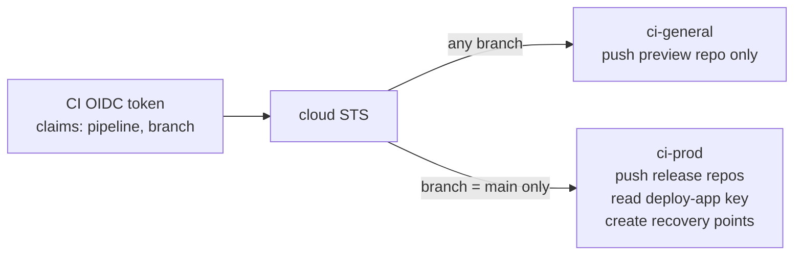

# Trunk-based delivery

One branch, short-lived PRs, every merge to main produces a deployable
image, and promotion to production is a reviewed git commit. The graph is
defined once in `infra/delivery/scripts/` and driven by either Buildkite or
GitHub Actions.

## Any language, one contract

The pipeline runs `make test lint` and `docker buildx build`; it does not
know whether the app is Go, Python, TypeScript or Elixir. Toolchains are
pinned per app. Private package indexes are BuildKit secrets, never build args.

## Images

| Branch | Tag | Repository |
| --- | --- | --- |
| main | `rel-<40-hex sha>` | `<app>` (release) |
| PR | `pr-<app>-<sha>` | preview repository |

Tags are immutable. If the tag already exists the build is skipped, so
re-running a pipeline costs nothing and can never produce a different image
for the same commit. Registry kind (ECR, Artifact Registry, GHCR) is
configuration. Images carry provenance and an SBOM.

## Two paths to a cluster

**Nonprod** needs no human step. **Prod** is a commit: the ApplicationSet
reads the app's values at the SHA inside the tag, so merged-but-unpromoted
changes never reach prod, and `git log` of the prod overlay is the release
history.

## The promotion step

The **regression guard** runs before fetch, after fetch and after the
backup: if the current prod SHA already contains the new SHA, the step exits
cleanly. Prod never moves backwards by accident.

=== "Buildkite"

    - gate: block step with `decision` and `backup` select fields
    - who may approve: `allowed_teams` from `infra/delivery/config.yaml`
    - approver: `BUILDKITE_UNBLOCKER`
    - stale gates: `cancel-superseded-blocks.sh` rejects older blocked builds
    - pipeline: `infra/delivery/buildkite/generate-pipeline.sh`
    - the tool itself: `infra/terraform/layers/deployment/buildkite`

=== "GitHub Actions"

    - gate: `production` environment with required reviewers
    - who may approve: reviewer teams from the access registry
    - approver: `github.triggering_actor`
    - stale gates: concurrency group cancels older pending runs
    - pipeline: `.github/workflows/delivery.yml`
    - the tool itself: `infra/terraform/layers/foundations/github-org`

## The CD tool is infrastructure too

What you would click in the CD tool's UI is Terraform: cluster, queue,
agent token, the pipeline and its trigger settings, teams and members from
the access registry, the GitHub `production` environment and its reviewers.
Only the per-commit step list is generated at run time, because "build the
affected apps only" cannot be a static definition.

## Credentials

Two GitHub Apps with disjoint permissions: one for PR comments, one for the
promotion push and the branch-protection bypass. Neither is a user token.

## Failures and previews

Hard failures on main post to a separate channel from deploys. Label a PR
`preview-<app>`; the PR build pushes `pr-<app>-<sha>` and the preview
ApplicationSet creates `preview-<app>-<n>` with an in-cluster database.
Removing the label or closing the PR prunes it.
