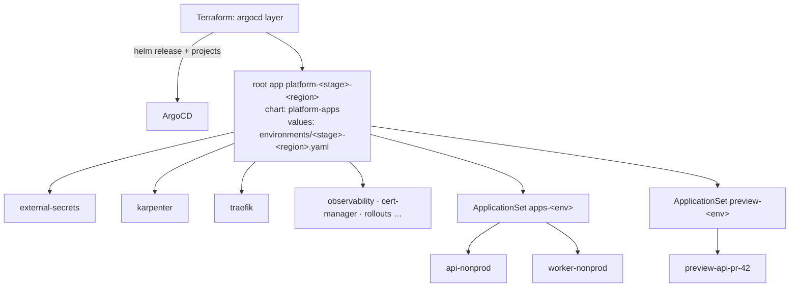
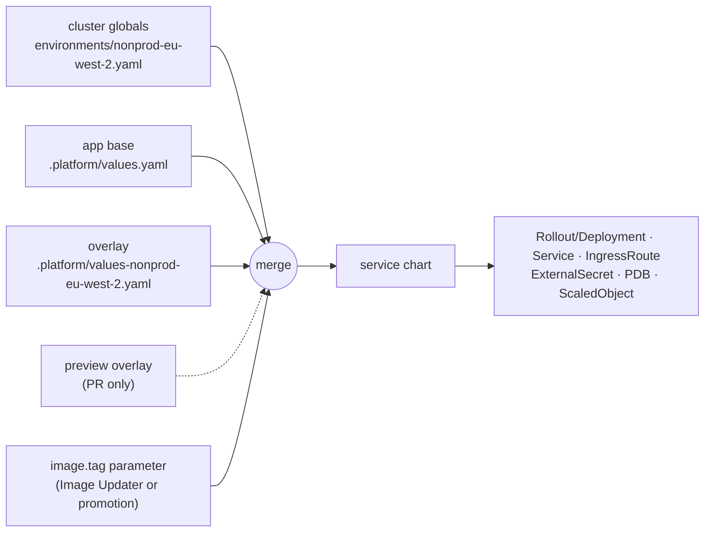
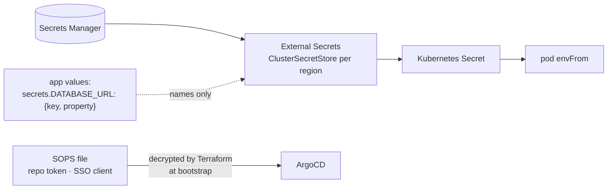

# GitOps with ArgoCD

## Bootstrap once, then git

The `argocd` Terraform layer installs ArgoCD, the AppProjects and one root
Application. After that nothing in a cluster is created by anything but
ArgoCD reading this repository.

One root, one values file per cluster. The ApplicationSets are chart
templates rendered from `global.stage` and `global.region`, so no file in
the repository lists regions.

## The app contract

| File | Meaning |
| --- | --- |
| `values.yaml` | base: image, port, resources, autoscaling, secret *names*, database |
| `values-<stage>-<region>.yaml` | overlay **and deployment gate**: no file, no Application |
| `preview.yaml` | overlay for PR previews |

## ApplicationSets

| | Nonprod | Prod | Preview |
| --- | --- | --- | --- |
| generator | git files `values-<stage>-<region>.yaml` on main | same | pull-request × git files `preview.yaml` at head SHA |
| revision | `main` | SHA inside the promoted tag; invalid tag → `invalid-prod-image-tag` (fails closed) | PR head SHA |
| image.tag | Image Updater, `^rel-[0-9a-f]{40}$`, newest | from the promotion commit | `pr-<app>-<sha>` |
| gate | overlay file exists | overlay file exists | label `preview-<app>` (default cluster) or `preview-<app>@<region>` |
| empty | n/a | n/a | `allowEmpty: true` |

`ignoreApplicationDifferences` on the Helm parameters keeps the AppSet
controller from overwriting what Image Updater wrote.

## Sync waves

```mermaid
gantt
  dateFormat X
  axisFormat %s
  section wave -1
    external-secrets, cert-manager, karpenter, rollouts (CRDs) :a, 0, 1
  section wave 0
    ClusterSecretStore, storage classes :b, 1, 2
  section wave 1
    NodePool, EC2NodeClass :c, 2, 3
  section wave 2
    traefik, metrics, observability :d, 3, 4
  section wave 3
    ApplicationSets (apps, preview) :e, 4, 5
```

The root app uses `ServerSideApply` and `SkipDryRunOnMissingResource`: the
same chart creates the Application that installs a CRD and a resource of
that CRD, and without the skip the first sync fails dry-run. Retry limit 20
with backoff, so a fresh cluster settles unattended.

## Secrets

- Runtime: External Secrets Operator. Apps declare `{key, property}`; the
  value never appears in git or in a plan.
- Bootstrap: only what ArgoCD needs before ESO exists, SOPS-encrypted with
  a per-tenant KMS key. No laptop key is a creation rule.

## Small decisions that mattered

- `managedNamespaceMetadata` on the Traefik namespace enables ALB readiness
  gates, so a pod is Ready only when the ALB says so.
- `ignoreDifferences` on `/spec/replicas` (autoscalers own it) and on
  Rollout `restartAt`/`paused` (operators and restarters own them).
- AppProjects bound namespaces per kind of workload (`app-*`, `preview-*`),
  so an app cannot target another app's namespace by editing its values.
