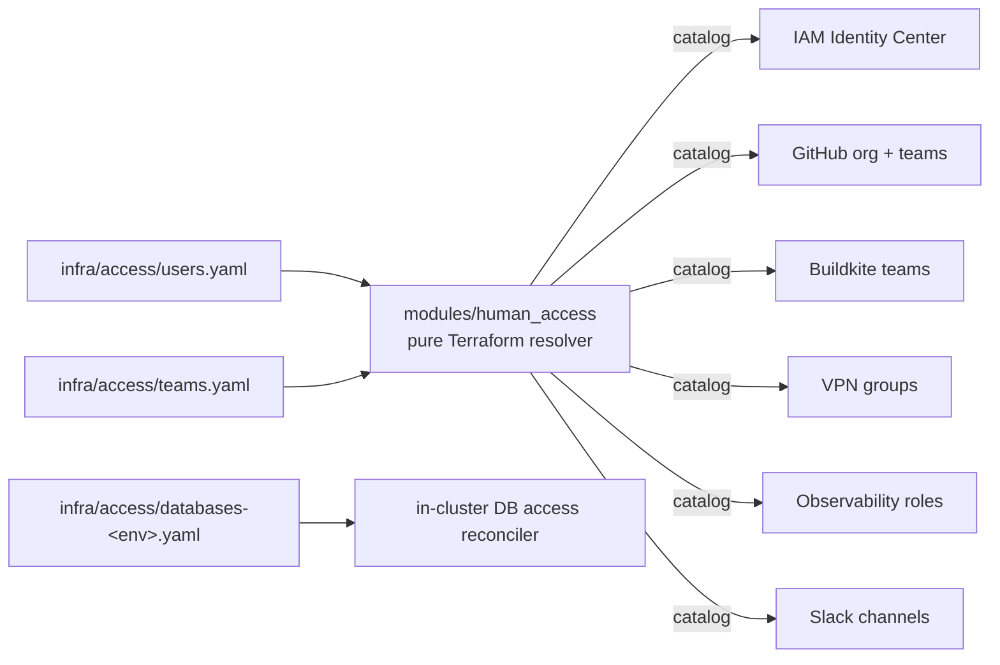
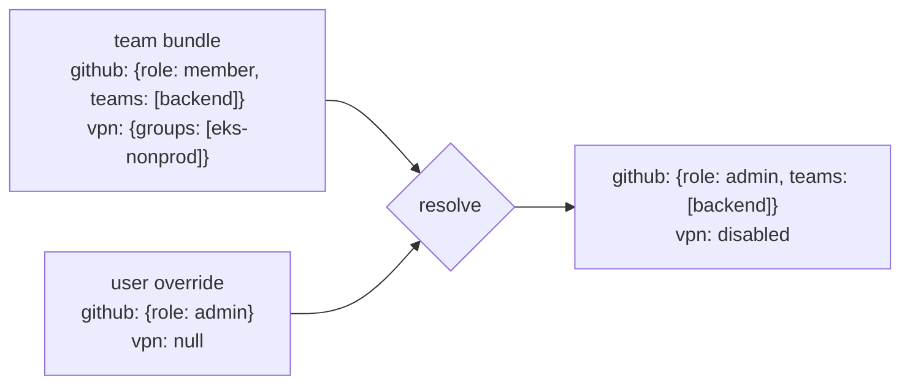
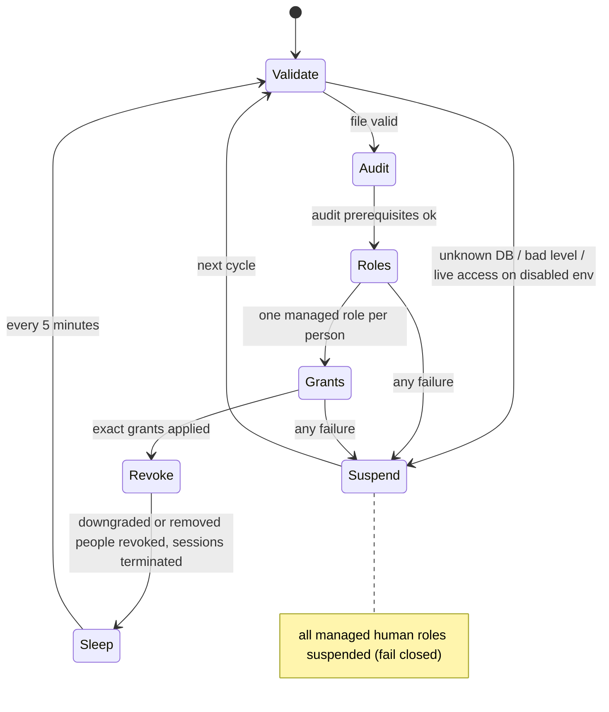

# Human access registry

One YAML entry per person, in git, reviewed like any other change, and read
by every system that grants access.

## Rules

| Rule | Why |
| --- | --- |
| Identity, SSO and database grants are never inherited from a team | the risky things stay explicit per person |
| A team bundle may carry lists: GitHub teams, VPN groups, Slack channels, SaaS roles | low-risk, high-volume access is where inheritance saves time |
| An explicit user field replaces the bundle's | no surprising unions |
| `access.<service>: null` disables the service for that person | opt out without deleting the bundle |
| Slack is additive | nobody is removed from a channel by a refactor |
| Unknown team or duplicate username fails the plan | the registry is validated, not trusted |

## One change, every consumer

Every consumer layer lists the registry files and the resolver in its
`include_patterns`. A PR that onboards a person shows the plan for the
GitHub org, Buildkite, the VPN, the observability roles, the Slack invites
and Identity Center in one comment, applied in one `digger apply`. Removing
a person is deleting a block; every consumer plans the removal.

## Database access

Grants live in a per-environment file and are reconciled by a small
Deployment in the cluster.

- Passwords are cleared every cycle. People connect with 15-minute IAM
  tokens over TLS.
- `default_transaction_read_only` is a guardrail; ACLs are authoritative.
- MFA is enforced in Identity Center, which has no API for it, and is the
  one manual step documented.
