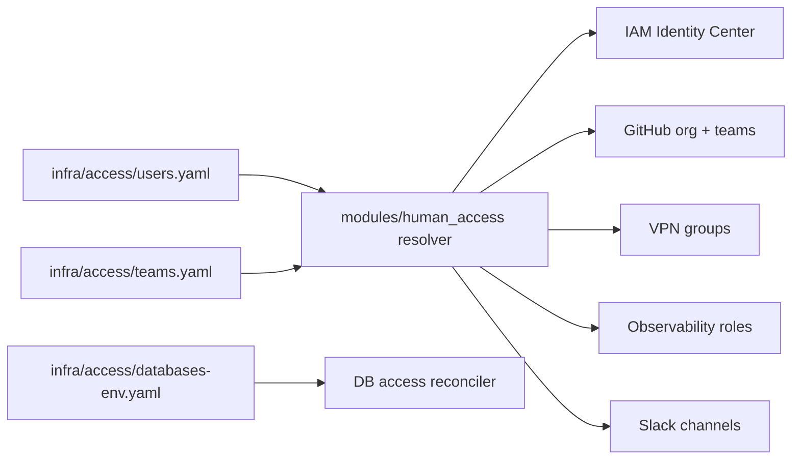

# Human access registry

One YAML entry per person, in git, reviewed like any other change, and read
by every system that grants access.

## Rules

| Rule | Why |
| --- | --- |
| Identity, SSO and database grants are never inherited from a team | the risky things stay explicit per person |
| A team bundle may carry lists: GitHub teams, VPN groups, Slack channels, SaaS roles | low-risk, high-volume access is where inheritance saves time |
| An explicit user field replaces the bundle's | no surprising unions |
| `access.<service>: null` disables the service for that person | opt out without deleting the bundle |
| Slack is additive | nobody is removed from a channel by a refactor |
| Unknown team or duplicate username fails the plan | the registry is validated, not trusted |

## One change, every consumer

Every consumer layer lists `infra/access/users.yaml`, `infra/access/teams.yaml` and the
resolver module in its `include_patterns`. A PR that onboards a person shows
the plan for the GitHub org, the VPN, the observability roles, the Slack
invites and Identity Center in one comment, applied in one `digger apply`.

## Database access

Database grants live in a per-environment file and are reconciled by a small
Deployment in the cluster, every 5 minutes:

1. Validate the file (unknown database, bad level, disabling an environment
   with live access: fail closed).
2. Create or update one personal role per person, marked as managed.
3. Apply exactly the declared grants, revoke everything else, and terminate
   sessions of anyone downgraded or removed.
4. Clear passwords every cycle: people connect with 15-minute IAM tokens over
   TLS, never with a password.
5. On any failure, suspend every managed human role until the next clean run.

MFA is enforced in Identity Center, which has no API for it, and is the one
manual step documented.
