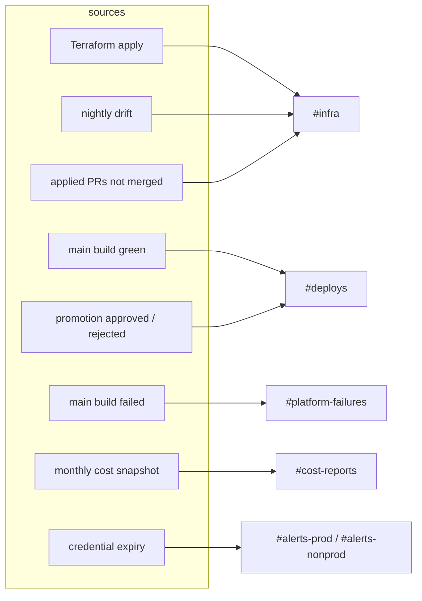
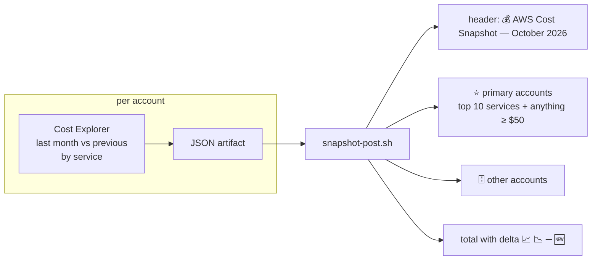

# Notifications

Slack carries outcomes people act on. Nothing is posted for a plan, a green
build or a routine sync.

| Message | Trigger | Script |
| --- | --- | --- |
| Terraform apply outcome | every `digger apply` run | `.github/scripts/digger/notify-apply-slack.sh` |
| Drift detected | nightly run with drift or errors | `.github/scripts/drift/notify-slack.sh` |
| Applied PRs waiting for merge | 07:00 and 19:00 on weekdays | `terraform-apply-reminder.yml` |
| Ready to promote / promoted / rejected | main build green, gate decision | `infra/delivery/scripts/slack-notify.sh` |
| Main build failed | hard failure on main | failure trap (Buildkite) or `failure()` job (GitHub Actions) |
| Monthly cost snapshot | 5th of the month | `.github/scripts/cost/snapshot-post.sh` |
| Credential expiry digest | daily, only when something expires within 30 days | registry-driven |

## Conventions

- Webhooks only, one secret per channel. No bot token with chat scope in CI.
- Block Kit with a plain-text fallback, so the message reads in notifications.
- Links to the run and to the PR in the first line.
- `@` neutralised in error text pasted from logs, so a plan cannot ping a group.
- Separate channels for *ship* and *fix*: the people who approve promotions
  are not the people who debug the runner image.

## Cost snapshot

Member accounts are queried directly because the payer view nets to zero
after credits.

## Credential expiry

A JSON registry of certificates and vendor credentials with `expires_at`,
`last_verified_at`, owner and renewal mode. The daily job ranks items into
expired / unknown / 7 / 14 / 30 days and posts a digest only when the list is
non-empty. The registry is validated in CI: unique ids, ISO dates that
round-trip, and a rule rejecting anything that looks like a PEM block.
