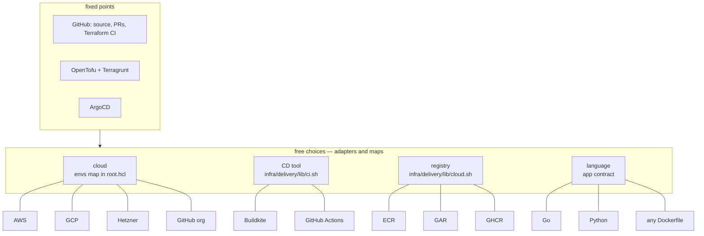
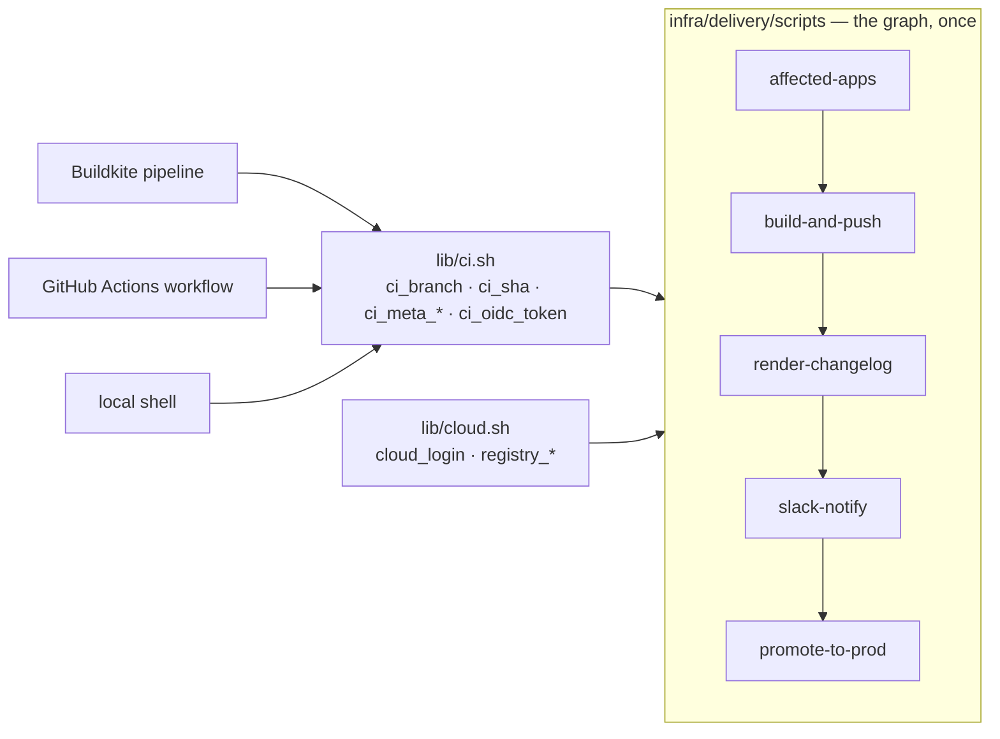

# Portability

The monorepo fixes three things: GitHub as the source of truth, OpenTofu +
Terragrunt for infrastructure, ArgoCD for clusters. Everything else is a
choice with more than one implementation in this repository.

## Clouds

| Cloud | Layer | Tenant entry | Auth in CI | State |
| --- | --- | --- | --- | --- |
| AWS | `workloads/eks`, `foundations/*` | `nonprod/uk`, `prod/uk`, … | OIDC + chain-assume | S3 per account |
| GCP | `workloads/gke` | `nonprod/gcp-eu` | Workload Identity Federation | GCS per project |
| Hetzner | `workloads/hetzner-k3s` | `nonprod/hetzner-eu` | API token from the secrets store | S3 in the organization account |
| GitHub | `foundations/github-org` | `shared/github` | App token | S3 in the organization account |

What makes this work with one `root.hcl`: the `envs` map carries `cloud`,
`id` and `state` per tenant; `remote_state.backend` is an expression, so S3
and GCS coexist; `iam_role` is set only for AWS tenants; the stage workflow
picks its auth step from the instance path; `digger.yml` does not know what
a project contains.

Adding Azure would be one `envs` entry with `state = { backend = "azurerm" }`,
one `workloads/aks` layer, one `azure/login` step guarded by `/azure-/`.

## CD tools

| | Buildkite | GitHub Actions |
| --- | --- | --- |
| pipeline | `infra/delivery/buildkite/generate-pipeline.sh` | `.github/workflows/delivery.yml` |
| prod gate | block step with fields | environment with required reviewers |
| the tool as code | `layers/deployment/buildkite` | `layers/foundations/github-org` |
| same scripts | yes | yes |

GitLab CI or Tekton would add a `ci.sh` branch and a pipeline file.

## Languages

`apps/example-api` is Go, `apps/example-worker` is Python. The pipeline
treats both identically: `make test lint`, `docker buildx build`, the
`.platform/` contract. Per-app `mise.toml` pins the toolchain so CI carries
no global language setup.

## What is provider-neutral by construction

| Convention | Why it carries over |
| --- | --- |
| path → tenant → backend | one map lookup |
| one instance = one state = one CI project | `digger.yml` is just an inventory, and it is generated |
| plan in PR, apply from PR, fingerprint the plan | computed from `show -json`, provider-agnostic |
| nightly drift with sticky PR | any project with `drift_detection: true` |
| registry-driven access | the resolver is pure Terraform; consumers are whatever providers exist |
| values-only app contract | the service chart does not care what is in the image |

## Earlier projects, same shape

The model was refined across projects before this one, each with a different
stack:

- **Hetzner + Cloudflare + Authentik**, OpenTofu with SOPS/age, `live/` per
  provider, `components/` for apps, databases, gitops and platform, and
  `deployments/` per client.
- **AWS EKS with Crossplane, Kong, Keycloak, sealed-secrets, ELK and
  Prometheus**, plus Packer images for a Nomad/Consul fleet.
- **A GitHub organization as code**: users, teams and repositories as
  Terraform.

What changed over time is what stayed: the path-derived tenant, the single
inventory file, apply-from-PR, and a registry for people. What was dropped:
per-root backend blocks, per-tool Makefiles, and any step that needed a
laptop with credentials.
