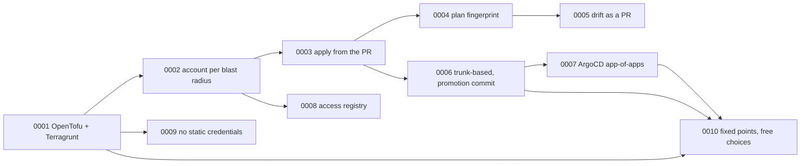

# Decision records

Short, one decision each. Status is "accepted" unless stated.

| # | Decision |
| --- | --- |
| [0001](0001-opentofu-and-terragrunt.md) | OpenTofu as engine, Terragrunt for path-derived configuration |
| [0002](0002-one-account-per-blast-radius.md) | One AWS account per blast radius, state per account |
| [0003](0003-apply-from-the-pr.md) | Plan and apply from the PR, merge after |
| [0004](0004-plan-fingerprint.md) | Apply only the plan that was reviewed |
| [0005](0005-drift-as-a-sticky-pr.md) | Drift is a PR, not a dashboard |
| [0006](0006-trunk-based-with-promotion-commit.md) | Trunk-based delivery; prod is a reviewed commit |
| [0007](0007-argocd-app-of-apps.md) | ArgoCD app-of-apps with values-only app contract |
| [0008](0008-access-registry.md) | One registry file drives all human access |
| [0009](0009-no-static-credentials.md) | OIDC everywhere, no static cloud credentials |
| [0010](0010-fixed-points-and-free-choices.md) | Fix the source of truth; keep cloud, CD tool and language replaceable |
