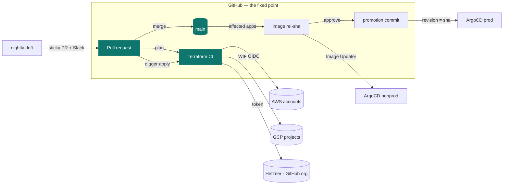

# Platform Blueprint

How I build and operate a platform: one monorepo, every change through a
reviewed pull request, nothing applied from a laptop, and every tool
replaceable except the source of truth.



## Fixed points and free choices

| Fixed | Free, with more than one implementation here |
| --- | --- |
| GitHub for source, PRs and Terraform CI | **Cloud**: AWS, GCP, Hetzner, GitHub-as-infra |
| OpenTofu + Terragrunt for infrastructure | **CD tool**: Buildkite or GitHub Actions |
| ArgoCD for cluster reconciliation | **Registry**: ECR, Artifact Registry, GHCR |
| One `.platform/` contract per app | **Language**: Go and Python examples, any Dockerfile works |

## Read in this order

| # | Guide | Answers |
| --- | --- | --- |
| 1 | [Architecture](01-architecture.md) | what is isolated from what, and why regions are never listed |
| 2 | [Terraform and Terragrunt](02-terraform-terragrunt.md) | how a path becomes an account, a backend and an identity |
| 3 | [PR workflow](03-pr-workflow.md) | how a change is planned, reviewed and applied in the right order |
| 4 | [Drift detection](04-drift-detection.md) | what happens when reality and git disagree |
| 5 | [Trunk-based delivery](05-trunk-based-delivery.md) | how a merge becomes an image and a prod release |
| 6 | [GitOps with ArgoCD](06-gitops.md) | how a cluster finds its apps |
| 7 | [Human access](07-human-access.md) | how one file grants and revokes access everywhere |
| 8 | [Notifications](08-notifications.md) | what reaches Slack and what does not |
| 9 | [Portability](09-portability.md) | what changes when the cloud, the CD tool or the language changes |

The [decision records](adr/README.md) hold one page per tool choice.

## The repository

```
apps/                 example-api (Go), example-worker (Python): Dockerfile + Makefile + .platform/
infra/terraform/      root.hcl, layers/<category>/<layer>/environments/<stage>/<leader>/<region>
infra/platform-config one YAML per cluster
infra/helm-charts/    platform-apps (cluster tools + ApplicationSets), service (one chart for every app)
infra/delivery/       tool-neutral delivery scripts, Buildkite generator, CI and cloud adapters
infra/access/         people, teams, database grants
.github/              Terraform CI, drift, cost, reminders, delivery on GitHub Actions, this site
digger.yml            generated project inventory
```

Everything is sanitized: fictional `acme` organization, placeholder account
IDs and example domains. The patterns and scripts are real.
